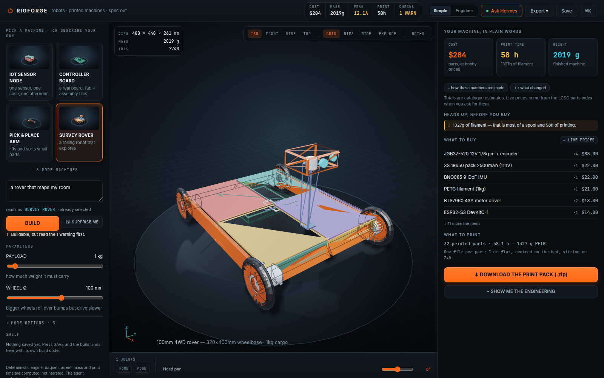
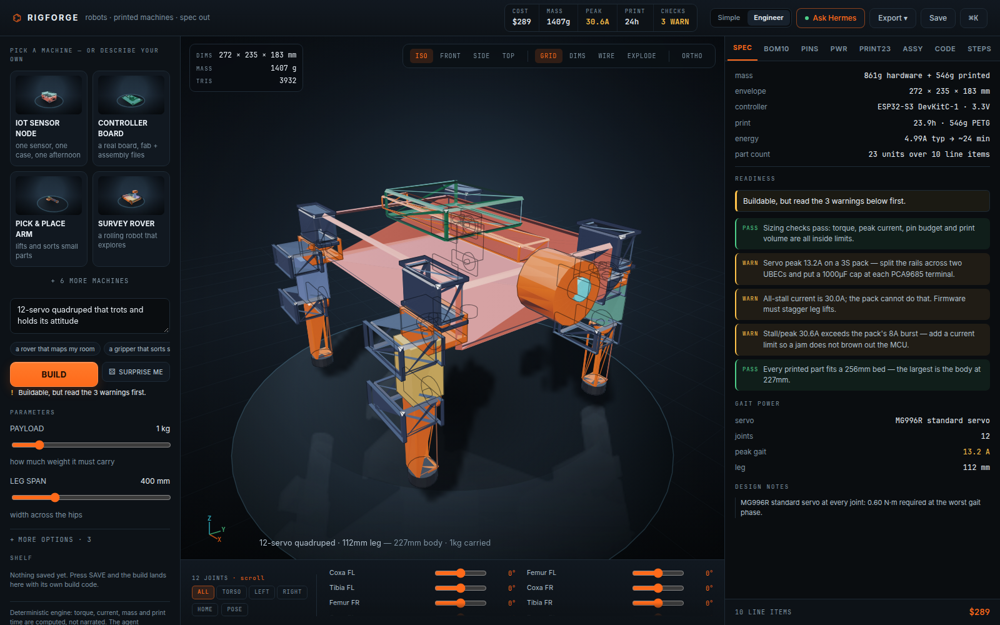
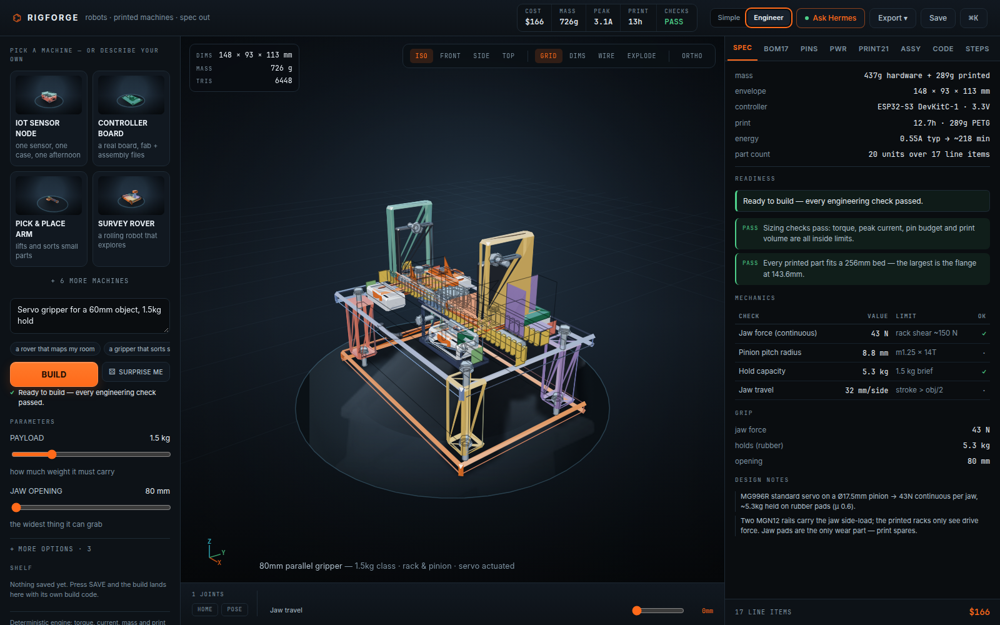
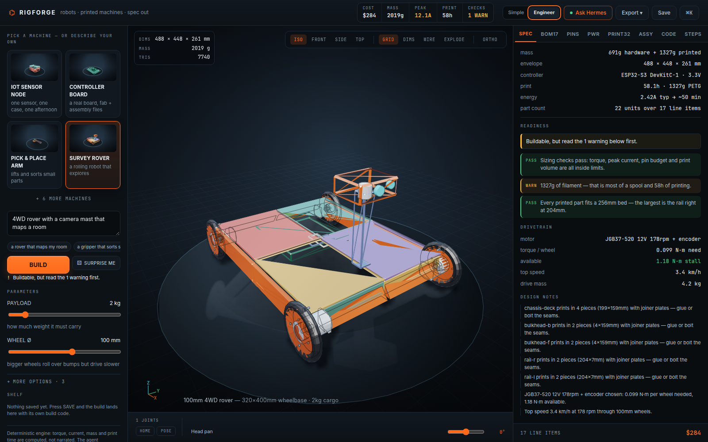
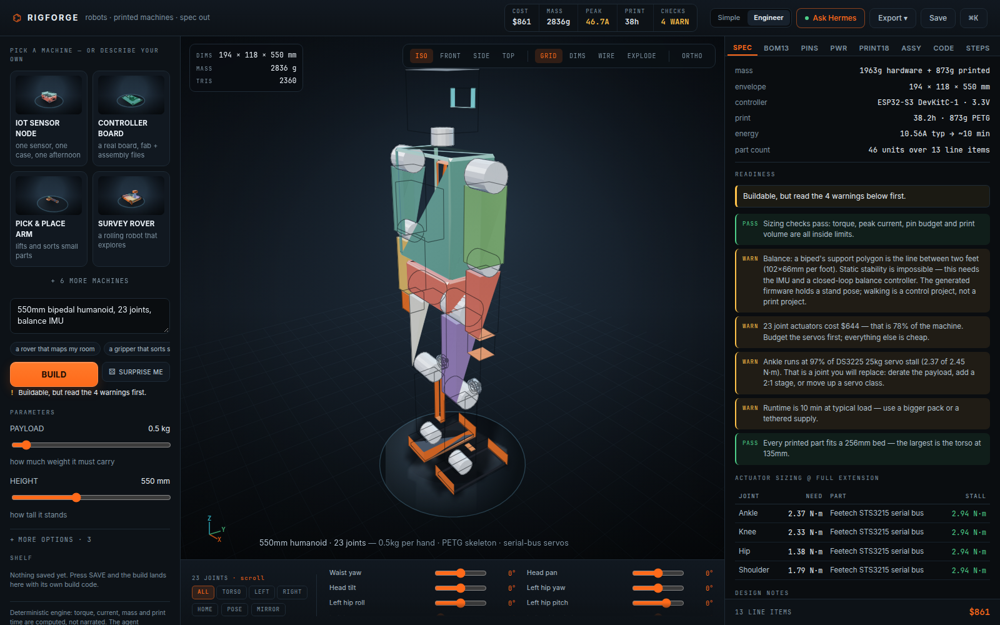
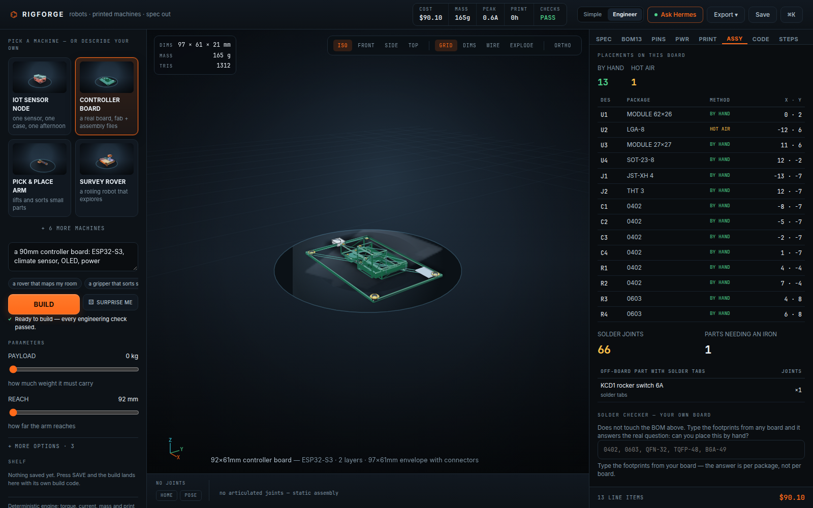
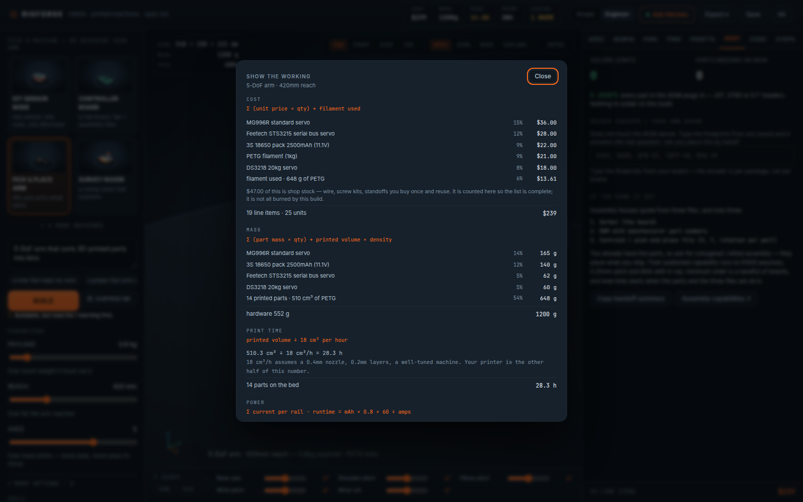
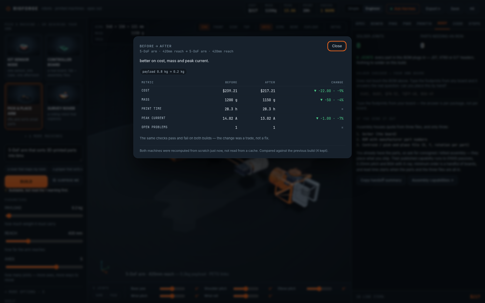

# Rigforge

**A build studio for robots and printed machines, inside Hermes Desktop.**



Schematik answers *"what circuits do I wire"*. Rigforge answers *"what do I build"* —
a complete machine from one brief:

| | |
|---|---|
| geometry | posed 3D assembly, orbit/zoom, joint sliders, real forward kinematics, exploded view |
| mechanics | joint torque cascade → servo/belt-stage selection, wheel torque → motor choice, link bending + deflection |
| power | per-rail typical and stall current → pack → runtime, wire gauge, fuse and connector sizing |
| electronics | pin map that refuses strapping pins and the flash bus, PCA9685 channels, UART bus reservation |
| firmware | Arduino skeleton generated from the same pin map — homing, encoders, gait loops |
| manufacturing | BOM with prices + SKUs, mass, print grams/hours, **bed-aware part splitting**, per-part STL pack (zip), OpenSCAD, assembly order |
| boards | a controller board you can design: placements, per-part solder verdicts, and a **board pack** (BOM + centroid/CPL + spec) for a fab or assembly house |
| trust | **show the working** on every headline number, and **before/after** on every change — recomputed, never remembered |
| sharing | a design is a **build code**: `RF1-…`, ~200 characters, rebuilds exactly on someone else's machine |

The engine is deterministic and offline: the same brief always produces the same
machine, and every number is computed (not narrated). The agent designs; the maths
is the studio's.

## Anybody can build

- **Click a machine card** — pick a robot dog, a gripper, a humanoid; the whole
  spec appears instantly. No typing required.
- **Or type one sentence and press Enter** — *"a robot car that maps my room"*
  is a complete brief.
- Every control says what it does in plain words, and the readiness block leads
  with a sentence — *"Ready to build — every engineering check passed."* — before
  the engineering tables a grown-up might want.

## Archetypes

Ten machines across three orders of magnitude, all from the same engine:

`iot` (sensor node in a printed case) · `pcb` (a real controller board, fab-ready) ·
`arm` (5-DoF) · `gripper` (parallel jaws on MGN12) · `rover` · `quadruped` (12 servos,
independent leg chains) · `humanoid` (23-joint biped, two servo buses) · `robot`
(mobile manipulator: 4WD base + arm + pan head) · `gadget` (ESP32 desk device) ·
`gantry` (metre-scale, belts + rails)

## What it refuses to fake

Every claim in the studio is checkable, and where it cannot be true the product says
so instead of hiding it. Things it caught in its own output:

- **Unprintable parts.** A 410mm rover rail used to ship as one piece with a vague
  warning. Parts now split themselves to *your* bed (180/220/256/300/350mm) with
  joiner plates, and the notes say which seams to glue.
- **STLs that were not slice-ready.** Per-part exports used to arrive in world space,
  floating mid-machine. They are now laid flat, centred and sitting on Z=0.
- **Payload it could not carry.** Asking for 40kg used to be silently clamped to 8kg
  with every check passing. Over-weight requests now fail loudly, and a joint beyond
  any servo + 4:1 belt reads `out of scope` rather than inventing a 7:1 stage.
- **Numbers you had to trust.** *Show the working* prints the formula, the inputs and
  the parts that dominate the total — cost, mass, print time, amps per rail.

| | |
|---|---|
|  |  |
|  |  |
|  |  |
|  |  |

## Sharing a design

**Export ▸ Build code** copies one line — `RF1-eyJhcm…`, about 200 characters.
Because a design is deterministic from its brief, that line *is* the machine: paste it
into **⌘K ▸ Open a build code** on any install and it rebuilds exactly, priced against
whoever opened it. No account, no cloud, nothing to sync. A bad paste is explained,
not silently ignored.

## The agent half

Two tools, one small state dir (`$HERMES_HOME/rigforge/*.json`):

| tool | does |
|---|---|
| `rigforge_build` | parses a sentence or a params object, queues the build, returns the brief + a `::rigforge{…}` directive |
| `rigforge_state` | reads back what the studio computed last: cost, mass, print hours, peak amps, readiness checks |

The loop is two files and no polling from Python:

```
agent --rigforge_build--> queue.json --GET /api/plugins/rigforge/queue--> studio page
agent <--rigforge_state-- state.json <--POST /api/plugins/rigforge/state-- studio page
```

Backend routes (`dashboard/plugin_api.py`, mounted at `/api/plugins/rigforge/`):

```
GET  /health
GET  /queue?peek=1&limit=5     read-only
GET  /queue?limit=5            drain (the page's poller — each request applied once)
POST /queue                    {"brief": …, "note": …}
GET  /state
POST /state                    the studio's computed summary
```

Payloads are bounded on the way in (text lengths, check count, clamped numbers), so
neither side can grow the store without limit.

## Where it lives

- UI page `/rigforge` + a sidebar row + five command-palette rows
- `::rigforge{brief={…}}` transcript directive — the **agent → plugin** door: the model
  writes one line in chat and a "load into studio" card appears
- **ASK HERMES** on the page stages a structured prompt with the live spec in the
  composer (plugin → agent), and tells the agent to reply with the same directive
- `rigforge_build` / `rigforge_state` tools + the queue/state routes above — the
  agent can start a build without a chat round-trip, and read the result back
- the topbar's **AGENT** chip is the honest liveness read: LINKED only when the
  plugin backend actually answered

## Install

```bash
node build.mjs                       # src/*.js → plugin.js (single file, no deps)
cp plugin.js ~/.hermes-webapp/desktop-plugins/rigforge/plugin.js   # webapp
cp plugin.js ~/.hermes/desktop-plugins/rigforge/plugin.js          # native desktop
```
Then reload the app (Cmd/Ctrl-R). Enabled by default; toggle in Capabilities ▸ Plugins.

## Develop

```
src/00-head.js        imports + why-this-exists
src/10-parts.js       the part catalogue (prices, torque, current, mass)
src/15-design.js      design builder + printed-volume model (wall shell, not solid)
src/20..29-*.js       archetype generators (arm, rover, quadruped, gripper/gadget,
                      full robot, humanoid, iot node, gantry, controller board)
src/30-analysis.js    pin map, power budget, mass/cost/print, readiness checks
src/35-firmware.js    Arduino generation + assembly steps
src/40-geometry.js    FK pass, meshes, STL / OpenSCAD / markdown / CSV exporters
src/45-compose.js     brief parsing, presets, agent prompt, directive parsing
src/50-viewport.js    software 3D renderer (painter's algorithm on 2D canvas)
src/55-styles.js      the studio's palette + element factory
src/44-share.js       build codes (RF1-…), encode/decode
src/56-panels.js      the eight spec tabs
src/58-assembly.js    solder verdicts, footprint checker, assembly-house handoff
src/59-audit.js       show the working — formulas and contributors
src/61-compare.js     before/after between two builds
src/62-a11y.js        dialog focus trap, Escape, focus restore
src/60-page.js        the page
src/70-register.js    routes / nav / palette / directive / settings
```

Tests (all run without the app):

```bash
node tests/engine-smoke.mjs     # numbers per archetype
node tests/render-ssr.mjs       # every component through real React 19 (SSR)
node tests/make-preview.mjs     # bundle a standalone preview page
node tests/shoot.mjs            # headless screenshots of every tab
node tests/shots-docs.mjs       # the README screenshots, current UI
node tests/capture-v4.mjs       # 1080p footage for the demo films
node tests/functional.mjs       # pose a joint, export an STL, verify the bytes
HERMES_HOME=$(mktemp -d) python3 tests/agent_half.py   # tools, store, HTTP routes
```

## Gotchas worth remembering

- `jsx` must receive `key` as the **third argument**; spreading it warns in React 19.
  The local `h()` factory handles that.
- A camera basis needs `up = back × right`. The byte-simple `[sy·sp, -cy·sp, cp]`
  is not orthogonal and shifts the whole frame downward — it looks like a CSS bug.
- The agent half's CLI verb (`hermes rigforge …`) is skipped under host isolation —
  drive it through `rigforge_build` or the routes instead.
- Desktop plugins may import only `@hermes/plugin-sdk`, `react`, `react/jsx-runtime`.
  The area constants (`ROUTES_AREA`, `SIDEBAR_NAV_AREA`, `PALETTE_AREA`,
  `TRANSCRIPT_DIRECTIVE_AREA`) and `__HERMES_PLUGIN_SDK__` are present in the live
  bundle — grep `apps/desktop/dist-webapp/assets/*.js` before relying on a name.
